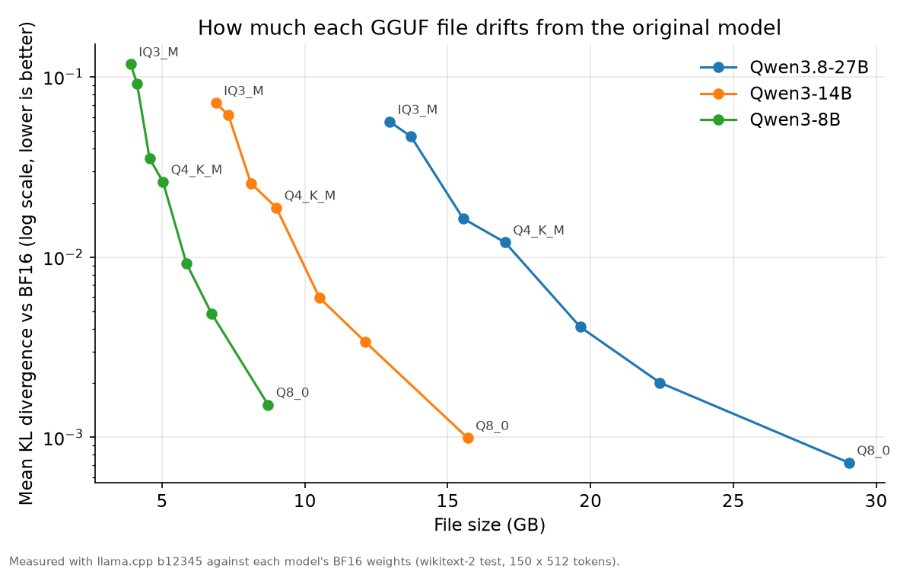
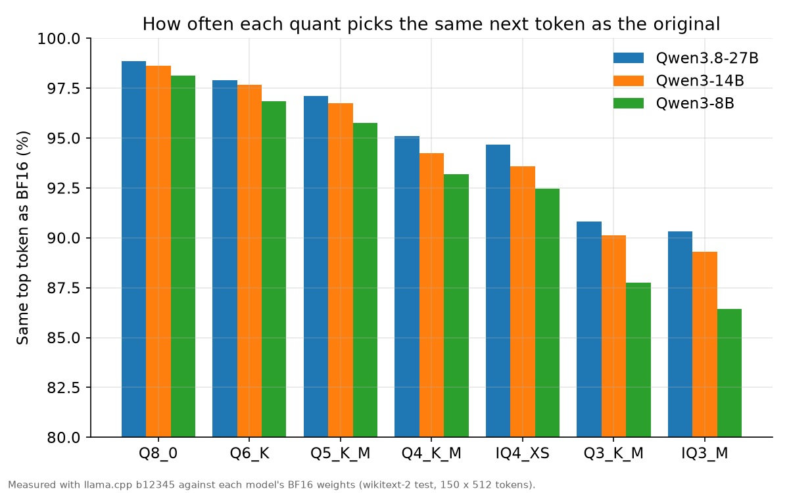
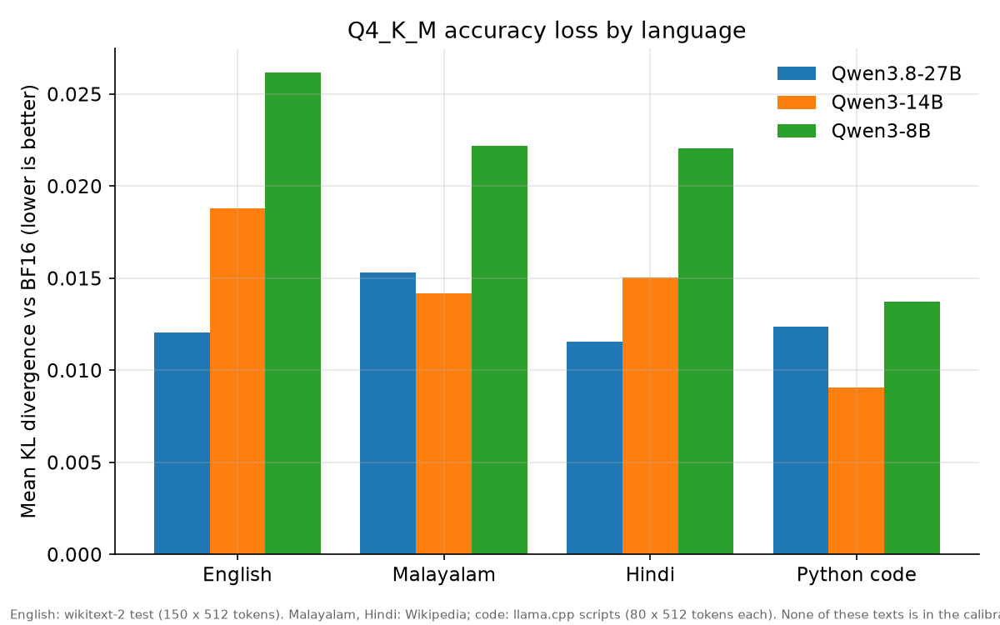

# I Quantized Three Qwen3 Models and Measured What Each GGUF File Loses

*Qwen3.8-27B, Qwen3-14B and Qwen3-8B, seven quant levels each, every file compared with the original weights. Bigger models lose less, and Q4_K_M is the right default for all three.*

<!-- Title options:
     1. I Quantized Three Qwen3 Models and Measured What Each GGUF File Loses
     2. Qwen3 27B vs 14B vs 8B in GGUF: Real Measurements, Not Guesswork
     Tags (5): LLM, Quantization, Machine Learning, Open Source, Artificial Intelligence
     Cover image: images/kld_vs_size.png -->

Every GGUF repo on Hugging Face has the same table: Q8_0, Q6_K, Q5_K_M, Q4_K_M and so on, with a note
like "recommended" next to one of them. What I could never find was how much each file actually differs
from the original model. "Q4_K_M is good enough" is probably true, but I wanted to see the number.

So I quantized three Qwen models myself, Qwen3.8-27B, Qwen3-14B and Qwen3-8B, and measured every file
against the original BF16 weights. This post is what I found, including the parts that went wrong.

Everything is public: the [21 GGUF files](https://huggingface.co/collections/muhammed-afsal-p-m/qwen3-quants),
the [pipeline code](https://github.com/muhammedafsalpm/qwen-gguf-quantization) and the raw results.

## Quantization in one paragraph

A model stores billions of numbers (weights), normally in 16 bits each. Quantization stores them with fewer
bits, for example 4. The file gets about four times smaller and runs on a smaller GPU, usually faster too.
The cost is a small rounding error in every weight. The question is how much those errors change what the
model says.

## How I measured it

I used llama.cpp (build b12345) for everything: conversion, quantization and evaluation.

**The importance matrix.** Before quantizing, llama.cpp can run the model over sample text and record which
weights matter most, then round those more carefully. The sample text matters, so I built 164K tokens from
six sources: Wikipedia, multi-turn chat, math word problems, Python code, long reasoning traces and
multilingual text. I rendered all of it with Qwen3's own chat template, including `<think>` blocks, so both
thinking and non-thinking modes are covered.

**KL divergence.** Perplexity is the usual metric, but it compares a model with the text, not with the
original model. KL divergence compares the two models directly: for every token of held-out text it measures
how far the quant's next-token probabilities are from BF16's. Zero means identical. I also tracked "same top
token": how often the quant's most likely next token matches the original's.

All of this ran on the wikitext-2 test split, 150 chunks of 512 tokens, which was not in the calibration data.

**Real questions.** Numbers on Wikipedia text don't tell you whether the model still reasons or calls tools,
so every file also answered the same 43 to 46 questions at temperature 0: logic, math, code, SQL, data
analysis, an agentic planning task, Malayalam and Hindi, and for the 27B model images. I read the answers
myself instead of trusting the automatic checks (more on why below).

## The results

At the recommended Q4_K_M level:

| Model | Q4_K_M size | Mean KLD vs BF16 | Same top token | Speed* |
|---|---|---|---|---|
| Qwen3.8-27B | 17.0 GB | 0.0121 | 95.09% | 43.7 tok/s |
| Qwen3-14B | 9.0 GB | 0.0188 | 94.25% | 80.9 tok/s |
| Qwen3-8B | 5.0 GB | 0.0262 | 93.18% | 140.3 tok/s |

\*One RTX 6000 Ada, all layers on the GPU.

Three things stood out.

**Bigger models lose less.** The 8B model drifts about twice as much as the 27B at every level. A smaller
model has less spare capacity, so each rounding error costs more. If you run 8B and care about quality,
Q5_K_M or Q6_K is worth the extra gigabyte.

**Q8_0 is practically the original.** 98 to 99% same top token for all three models. If it fits, there's no
reason to keep the BF16 file around.

**The drop below 4 bits is steep.** Going from Q4_K_M to Q3_K_M more than triples the KL divergence on all three
models. Still, the larger models handled it better than I expected: every 27B quant, down to IQ3_M (13 GB),
answered every graded question correctly, including reading numbers off a chart and an invoice.

## Which file for which GPU

These assume about 8K tokens of context; longer context needs more memory.

- **8 GB:** Qwen3-8B Q4_K_M, or Qwen3-14B IQ3_M with a short context
- **12 GB:** Qwen3-14B Q4_K_M (my pick for most people at this size)
- **16 GB:** Qwen3-14B Q6_K, or Qwen3.8-27B IQ3_M
- **24 GB:** Qwen3.8-27B Q4_K_M
- **32 GB and up:** Qwen3.8-27B Q6_K or Q8_0

## Malayalam and Hindi

I'm from Kerala, so I wanted to know whether quantization hurts Malayalam more than English. Models see
much less Malayalam text in training, and I expected it to suffer first.

It mostly didn't. For 14B and 8B, KL divergence on Malayalam and Hindi Wikipedia text was actually *lower*
than on English. The 27B model was the exception, with Malayalam slightly higher (0.0153 vs 0.0121). The test
texts differ in topic, so I'd treat the language gap as approximate rather than exact.

The question tests told a slightly different story for the smallest files. The 8B model sometimes used
non-standard Malayalam spellings even at Q8_0, so that's the model, not the quantization. On 14B, Q4_K_M and
above made no Malayalam or Hindi mistakes, while IQ4_XS and below misspelled "Delhi" in Malayalam.

## What went wrong

**My grader was wrong, not the model.** On the 14B run, every single quant "failed" the same revenue
question. That looked like a real problem until I read the answers: they all said a 40% increase, written in
LaTeX as `40\%`, and my check was looking for `40%`. I fixed the check, re-graded all three models, and made
sure no earlier result changed. The same thing happened with Malayalam: there are several valid spellings of
"Delhi" and my first check accepted only one. If I had trusted the automatic scores, I would have published
wrong numbers.

**Higher bits weren't always better on the questions.** On 8B, Q8_0 scored 15 of 17 on the extended set
while Q4_K_M scored 17. Q8_0 hit the thinking-token limit on one question and didn't ask for approval before
sending an email on another. With one run per question, a difference of one or two answers is noise. That's
exactly why I rely on KL divergence for the ranking and use the questions only to check that nothing breaks.

**The boring problems took the most time.** My internet dropped in the middle of the Hugging Face uploads (the
upload tool resumed where it stopped, and data already sent didn't go again). A Windows console encoding error crashed one pipeline step when it
tried to print a tokenizer symbol. And Ollama couldn't load the 27B files, because recent llama.cpp stores
some of that model's tensors in a newer layout. The 14B and 8B files work fine in Ollama.

## Try it

- **Run on your machine:** `ollama run hf.co/muhammed-afsal-p-m/Qwen3-14B-GGUF:Q4_K_M`, or download a file and
  run `llama-server -m Qwen3-14B-Q4_K_M.gguf -ngl 99 -c 16384 --jinja`
- **Run free on Kaggle:** [notebook link — add after publishing] loads any of the three on a T4 GPU.
- **Models:** [Qwen3 Quants collection on Hugging Face](https://huggingface.co/collections/muhammed-afsal-p-m/qwen3-quants)
- **Code and raw results:** [github.com/muhammedafsalpm/qwen-gguf-quantization](https://github.com/muhammedafsalpm/qwen-gguf-quantization)
- **Benchmarks as CSV:** [Kaggle dataset link — add after publishing]

If you run these on a different GPU or find a case where a quant breaks, I'd like to hear about it in the
comments.

*All credit for the models goes to the Qwen team. The quantization was done with llama.cpp.*
